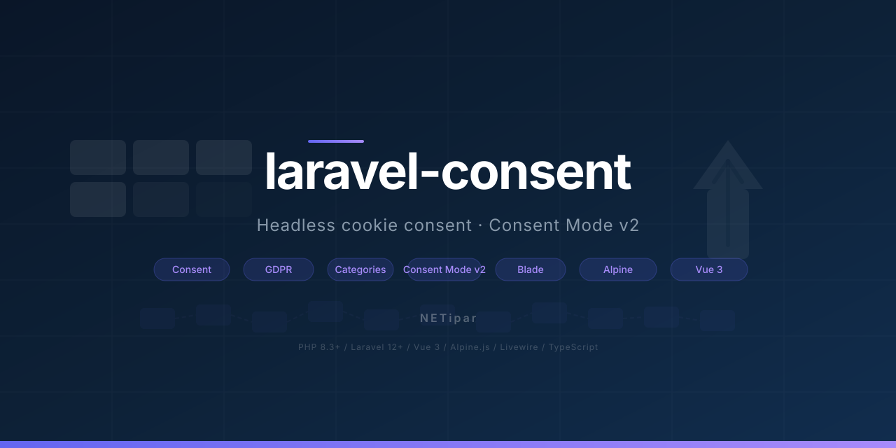

<picture>
  <source media="(prefers-color-scheme: dark)" srcset="art/banner.svg">
  
</picture>

# Consent for Laravel

[](https://packagist.org/packages/netipar/laravel-consent)
[](https://github.com/NETipar/laravel-consent/actions?query=workflow%3Atests)
[](https://packagist.org/packages/netipar/laravel-consent)

Headless cookie consent for Laravel: a versioned consent cookie, a server-side API and a Blade directive, a framework-free JavaScript core with **Google Consent Mode v2 (Basic)**, and unstyled **Alpine/Livewire** and **Vue 3** adapters. The package ships behaviour and accessibility wiring — your application owns all markup and styling (Tailwind, shadcn-vue, plain CSS).

> Coming from `netipar/cookie-consent` 1.x? See [UPGRADE.md](UPGRADE.md).

## Contents

- [Why Consent](#why-consent)
- [Requirements](#requirements)
- [5-minute quickstart (Blade and Livewire)](#5-minute-quickstart-blade-and-livewire)
- [Inertia and Vue 3 quickstart](#inertia-and-vue-3-quickstart)
- [The cookie contract](#the-cookie-contract)
- [Complete withdrawal](#complete-withdrawal)
- [Consent log](#consent-log)
- [Cookie table](#cookie-table)
- [Texts and languages](#texts-and-languages)
- [Server-side API](#server-side-api)
- [Gating third-party scripts](#gating-third-party-scripts)
- [Google Consent Mode v2](#google-consent-mode-v2)
- [Accessibility](#accessibility)
- [Interop with laravel-office-leads](#interop-with-laravel-office-leads)
- [Testing in your application](#testing-in-your-application)
- [Configuration](#configuration)

## Why Consent

- **Opt-in by construction.** Nothing optional is pre-checked, "Reject all" is a first-class action, and no decision means no optional category.
- **Versioned.** Change the policy, bump `version`, and every visitor is asked again.
- **Withdrawal that works.** Revoking a category deletes its cookies and, because loaded tags cannot be unloaded, reloads the page.
- **Headless.** One state machine, three UIs (Blade/Alpine, Vue, your own); the package adds no CSS.
- **Proof of consent.** An optional, append-only consent log with a hashed IP, for GDPR Art. 7(1).
- **Typed and tested.** PHPStan level max, strict TypeScript, Pest and Vitest suites.

## Requirements

- PHP **8.3+**, Laravel **12 or 13**
- Node **18+** for the npm adapters (`@netipar/consent-core`, `-alpine`, `-vue3`)

## 5-minute quickstart (Blade and Livewire)

**1. Install.**

```bash
composer require netipar/laravel-consent
php artisan vendor:publish --tag=consent-config
npm install @netipar/consent-core @netipar/consent-alpine
```

**2. Place the config and the banner** in your layout:

```blade
<head>
    …
    @consentConfig
</head>
<body>
    …
    <x-consent::banner />
</body>
```

**3. Register the adapter** before Alpine starts (`resources/js/app.js`):

```js
import { Alpine, Livewire } from '../../vendor/livewire/livewire/dist/livewire.esm';
import { registerConsent } from '@netipar/consent-alpine';
import { readConsentConfig } from '@netipar/consent-core';

registerConsent(Alpine, readConsentConfig());
Livewire.start();
```

**4. Let visitors change their mind** with a footer control:

```blade
<button type="button" data-consent-focus-return x-data x-on:click="$store.consent.openSettings($el)">Cookie settings</button>
```

**5. Style it.** The default markup has no classes. Pass `class="…"` to `<x-consent::banner>` and use the `settings` slot to restyle the dialog; see the [integration guide](docs/en/integration.md) and the [cookbook](examples/README.md).

## Inertia and Vue 3 quickstart

```bash
composer require netipar/laravel-consent
php artisan vendor:publish --tag=consent-config
npm install @netipar/consent-core @netipar/consent-vue3
```

Share the client config (it is resolved per request, so the locale is right):

```php
// HandleInertiaRequests::share()
'consent' => fn () => \NETipar\Consent\Facades\Consent::clientConfig(),
```

Install the plugin in the app setup shared by the client and server entries. It is SSR-safe: on the server (no `document`) the plugin provides an inert manager — undecided, prompt open, no-op actions — so `<ConsentBanner>` renders without throwing; the consent UI is effectively client-side (the browser creates the real manager and hides the prompt on mount for visitors who already decided):

```ts
import { createConsentPlugin, type ConsentConfig } from '@netipar/consent-vue3';

createInertiaApp({
    setup({ el, App, props, plugin }) {
        createApp({ render: () => h(App, props) })
            .use(plugin)
            .use(createConsentPlugin(props.initialPage.props.consent as ConsentConfig))
            .mount(el);
    },
});
```

Use the renderless `<ConsentBanner>` with your own components. Slot props are raw refs, so read them with `.value`:

```vue
<ConsentBanner
    v-slot="{ texts, categories, promptOpen, settingsOpen, selection, acceptAll, rejectAll, openSettings, closeSettings, toggle, saveSelection }"
>
    <section v-if="promptOpen.value" role="dialog" aria-modal="false" aria-labelledby="consent-title" aria-describedby="consent-description" tabindex="-1">
        <h2 id="consent-title">{{ texts.title }}</h2>
        <p id="consent-description">{{ texts.description }}</p>
        <Button @click="acceptAll">{{ texts.acceptAll }}</Button>
        <Button @click="rejectAll">{{ texts.rejectAll }}</Button>
        <Button variant="outline" @click="openSettings">{{ texts.settings }}</Button>
    </section>

    <Dialog :open="settingsOpen.value" @update:open="(open: boolean) => !open && closeSettings()">
        <!-- one checkbox per category, bound to selection[category.key] and toggle(category.key) -->
    </Dialog>
</ConsentBanner>
```

A complete shadcn-vue dialog is in the [integration guide](docs/en/integration.md#consentbanner).

## The cookie contract

| Cookie | Value | Notes |
|---|---|---|
| `__cookie_consent` | the granted categories, comma-separated and URL-encoded: `necessary%2Canalytics` | Required categories are always present once a decision exists. |
| `__cookie_consent_v` | the config `version`, verbatim | A decision is valid only when **both** cookies exist and the version equals the config. |
| `__cookie_consent_id` | a UUID | Only when the [consent log](#consent-log) is enabled. A necessary cookie, never part of the value cookie. |

All are written with `Path=/`, `Max-Age = lifetime_days × 86400`, `SameSite=Lax` and `Secure` on HTTPS (all configurable). Names, lifetime and attributes live in `config/consent.php`; `CONSENT_LIFETIME_DAYS` overrides the lifetime (default 365).

- The server reads the **raw `Cookie` header** only. `EncryptCookies` blanks JS-written cookies in `$request->cookie()`, so the cookie bag is never consulted.
- **Duplicate value cookies.** With `cookie.domain` set the package never writes a host-only cookie, so a second `__cookie_consent` in the header is a legacy host-only copy shadowing the real one — and the header cannot tell which is newer. The reader then treats the request as **no decision** (`allows()` is `false` for optional categories) until the JS core has deleted the stray copy on the next page load. Without `cookie.domain` the reader keeps the first one, in the order the browser sends them.
- **Versioning.** Bump `version` (`'1'` → `'2026-10'`) whenever the policy changes. A visitor whose stored version differs has no decision: the prompt shows again, optional categories are denied, `Consent::allows()` is `false`, and the JS core deletes the stale value cookie on first sight (so other server-side readers stop honouring it) and purges the optional categories' cookies.
- **Withdrawing** is a browser action (`manager.withdraw()`, `$store.consent.withdraw()`, `useConsent().withdraw()`): it deletes both cookies and shows the prompt again.

## Complete withdrawal

Withdrawing consent must also remove what was set under it, so list the cookies of every category:

```php
'analytics' => [
    'required' => false,
    'cookies' => ['_ga', '_ga_*', '_gid', '_gat_*', '_dc_gtm_*'],
],
'marketing' => [
    'required' => false,
    'cookies' => ['_gcl_au', '_gcl_aw', '_gcl_*', '_gac_*'],
],
```

An entry is an exact name or a prefix pattern ending in `*` (or a rich array, see [Cookie table](#cookie-table)). These are the first-party names Google documents for GA4 and Google Ads at [business.safety.google/adscookies](https://business.safety.google/adscookies/); verify them against the tags you use.

**When cookies are deleted.** On every transition that removes a previously granted category — saving fewer categories, "Reject all", withdrawing — and, for all optional categories, when a stale version is detected. A change made in another tab is handled the same way on the next `sync()`, which runs on `livewire:navigated`, when the tab becomes visible again (`visibilitychange`) and on a bfcache restore (`pageshow` with `persisted`); disable the last two with `syncOnVisibility: false`. Required categories are never purged.

**Where.** Each cookie is deleted without a `Domain` attribute, then with the current host, then with each parent domain (`www.example.com` → `example.com`), because Google Analytics sets `_ga*` on the registrable domain.

**Reload.** Scripts that already ran cannot be unloaded: gtag.js would simply recreate `_ga` on its next hit. When a revoked category had something loaded for it (a gated script ran, a Google tag was configured) and `reload_on_revoke` is `true` (the default), the page reloads once after the listeners have finished. Set it to `false` if you handle this yourself.

**Housekeeping on every page load.** Once a visitor has decided, the JS core removes the configured cookies (`categories.*.cookies`, exact names and `prefix*` patterns, on the host and every parent domain) of every optional category that is not granted — on the initial page load and on every re-sync (Livewire navigation, tab becoming visible, bfcache restore), not only at the moment of a revocation. So a tag that loaded before the decision, or a second tab that kept writing `_ga*`, cannot leave residue behind. Visitors who have not decided yet are never touched (nothing is purged before a decision), required categories are never purged, and this cleanup never triggers a page reload, because nothing was loaded for a category that is not granted.

**What the package does not do.** It does not expire third-party cookies from the server. A response can only guess the `Domain` and `Path` of a cookie the server merely saw by name, the two transitions that matter (reject and withdraw) happen in the browser with no round trip, and a response-mutating middleware is exactly what this package avoids. If an audit finds residue, add a terminating middleware in your application.

## Consent log

An optional proof of consent (GDPR Art. 7(1)): who decided what, under which policy version, and when. Off by default.

**Enable.**

```dotenv
CONSENT_LOG_ENABLED=true
```

```bash
php artisan vendor:publish --tag=consent-migrations   # optional: take the migration into your app
php artisan migrate
```

Set the variable **before** the first `migrate`: the package loads its migration only while the log is enabled. A published copy keeps the same file name, so it never runs twice. Pick `log.table` (at most 36 characters) and `log.connection` before migrating and do not change them afterwards. `migrate:rollback` runs `down()`, which drops the table **and the proof in it**.

**What is recorded** — one append-only row per decision in `consent_logs`, with the columns the shipped migration defines:

| Column | Type | Notes |
|---|---|---|
| `id` | bigint, primary key | |
| `event_id` | uuid, unique | Generated by the browser per transition; makes the POST idempotent. Stored lowercase. |
| `consent_id` | uuid | From the `__cookie_consent_id` cookie; groups one visitor's decisions. Stored lowercase. Indexed together with `created_at`. |
| `action` | string(16) | `accept_all`, `reject_all`, `save` or `withdraw`. |
| `granted` | json | Granted category keys in config order; required categories always included. |
| `version` | string(64) | The config version the visitor saw, as sent. |
| `url` | string(2048), nullable | The pathname only — query strings and fragments are dropped. |
| `ip_hash` | string(64), nullable | `HMAC-SHA256` with the app key over the /24 (IPv4) or /48 (IPv6) prefix. The raw IP is never stored. `log.store_ip` switches it off. |
| `user_agent` | string(255), nullable | Raw, scrubbed to valid UTF-8 and truncated to `log.user_agent_max_length`. `log.store_user_agent` switches it off. |
| `user_id` | string(64), nullable, indexed | `Auth::id()` when a user is authenticated; an identifier longer than 64 characters is stored as `null`. `log.store_user_id` switches it off. |
| `created_at` | datetime, indexed | Server time. There is no `updated_at`. |

The IP is both truncated and keyed: truncation alone leaves 24 bits of the real address, and a keyed hash of a full IPv4 address can be brute-forced by anyone holding the key. Records from the same /24 still correlate within one application; rotating `APP_KEY` breaks that correlation for older rows. The user agent stays readable so a data subject can recognise "their browser" in a dispute.

**The endpoint.** After every actual change of the decision the JS core sends `POST /consent/log` (the prefix comes from `log.route.prefix`) with `credentials: 'same-origin'` and `keepalive: true`, and never waits for the answer:

```json
{ "event_id": "…", "consent_id": "…", "action": "save", "granted": ["necessary", "analytics"], "version": "2026-10", "url": "/pricing" }
```

The route runs in the `web` middleware group (session and CSRF — the core sends the `XSRF-TOKEN` cookie value as `X-XSRF-TOKEN` and, without that cookie, the `csrf-token` meta tag value as `X-CSRF-TOKEN`) plus `throttle:consent-log` (`log.route.throttle` requests per minute per IP). Answers: `204` stored, `422` invalid payload, `419` CSRF failure, `429` throttled. Replaying an `event_id` is a `204` no-op. With the log disabled the route does not exist (`404`). Prefix, middleware and throttle are fixed at boot.

**Failure semantics.** A failed log call dispatches a `consent:log-failed` event on `document` (`detail: { action, error }`) and is **not retried**: the cookies are authoritative, so a lost entry is a lost proof, not a broken consent. Repeating an identical decision is not logged — the original record already proves it.

**Lookup.**

```php
use NETipar\Consent\Facades\Consent;

$consentId = Consent::consentId();       // the id cookie of the current request, or null
$events = Consent::history($consentId);  // Collection<int, ConsentLog>, oldest first
```

`history()` throws `NETipar\Consent\Exceptions\LogDisabledException` while the log is disabled and `InvalidArgumentException` for a non-UUID.

**Retention.** `log.retention_days` (default 365, never less than `cookie.lifetime_days`) drives `ConsentLog::prunable()`. Package models are not discovered by `model:prune`, so schedule it explicitly in `routes/console.php`:

```php
use Illuminate\Support\Facades\Schedule;
use NETipar\Consent\Models\ConsentLog;

Schedule::command('model:prune', ['--model' => [ConsentLog::class]])->daily();
```

Describe the log, its purpose and its retention in your privacy notice.

## Cookie table

Declare cookies with metadata and render them on your policy page, so the page cannot drift from what the site really sets:

```php
'analytics' => [
    'required' => false,
    'cookies' => [
        [
            'name' => '_ga',
            'provider' => 'Google Analytics',
            'purpose' => ['en' => 'Distinguishes visitors', 'hu' => 'Látogatók megkülönböztetése'],
            'lifetime' => 'P2Y',
        ],
        '_ga_*',   // purged on revocation, not listed
    ],
],
```

Plain strings are purge-only; rich arrays are purged **and** listed. `purpose` is a text, a lang key or a `[locale => text]` map; `lifetime` is `'session'` or an ISO 8601 duration, rendered in the unit as written and in the current locale (`P90D` → "90 days" / "90 nap").

```blade
<x-consent::cookie-table />
<x-consent::cookie-table :only="['analytics', 'marketing']" :show-empty="false" />
```

`Consent::cookieTable()` returns the same data for your own markup (a slot replaces the default table). In Vue, pass `Consent::cookieTable()` and `__('consent::consent.cookies.headings')` as Inertia props to `<ConsentCookieTable :categories="…" :headings="…" />`. Details: [integration guide](docs/en/integration.md#cookie-table).

## Texts and languages

The package ships `de`, `en`, `es`, `fr` and `hu` (formal register). Every string — banner copy, category labels and descriptions, table headings — comes from `lang/<locale>/consent.php`, and `Consent::clientConfig()` resolves them for the request locale, so the Blade view, Alpine and Vue render exactly the same text.

```bash
php artisan vendor:publish --tag=consent-lang   # → lang/vendor/consent/{locale}/consent.php
```

Override only the keys you want to change. Props and slots always win over the lang texts. `policy_url` accepts a URL, a `[locale => url]` map or a route name, resolved per request.

Known limitation: the strings are resolved on the server per request and captured when the JS manager is created. A client-side-only locale switch without a page render keeps the previous strings until a reload or re-initialisation.

## Server-side API

```php
use NETipar\Consent\Facades\Consent;

Consent::allows('analytics');   // bool — false until a valid decision exists; required categories: true
Consent::granted();             // list<string> — granted keys, required ones always included
Consent::hasDecision();         // bool — a decision for the current config version exists
Consent::decision();            // ConsentDecision { granted, version }
Consent::categories();          // list<Category> — key, required, label(), description()
Consent::clientConfig();        // array — what @consentConfig prints, locale-resolved
```

`allows()` throws `UnknownCategoryException` for a key that is not configured. Pass a `Request` as the last argument to evaluate a specific request.

In Blade:

```blade
@consent('analytics')
    <p>Analytics are on.</p>
@else
    <p>Analytics are off.</p>
@endconsent
```

`@unlessconsent('x')` and `@elseconsent('x')` (always with an argument) exist as well. **Never write a bare `@elseconsent`** — it fails at run time; use `@else`. Keep whitespace before `@else` and `@endconsent`. `@consentConfig` prints `<script type="application/json" id="consent-config">…</script>`.

## Gating third-party scripts

Change `type` to `text/plain` and name the category:

```html
<script type="text/plain" data-consent="marketing" nonce="{{ $nonce }}">
    // runs after "marketing" is granted
</script>
```

This works with `src`, `async`/`defer`, `data-consent-type="module"` and several categories (`data-consent="analytics marketing"` — all must be granted). The nonce is copied. Scripts are re-scanned after every decision, on `livewire:navigated` and on `manager.sync(root)`. See the [integration guide](docs/en/integration.md#gated-scripts).

## Google Consent Mode v2

```php
'google' => [
    'tags' => [
        ['id' => 'G-XXXXXXX', 'category' => 'analytics'],
        ['id' => 'AW-XXXXXXXXX', 'category' => 'marketing'],
    ],
    // 'signals', 'ads_data_redaction', 'url_passthrough': see the configuration reference
],
```

**Basic** mode: Google tags do not load at all without consent. After the first grant of a tag's category the core sends `consent default` with the four signals (`ad_storage`, `analytics_storage`, `ad_user_data`, `ad_personalization`), loads `gtag.js` and configures the granted tags. A later grant sends `consent update` plus `config` for the tags that just became granted. A revoke sends `consent update` with the signals `denied`, purges the cookies and — since loaded tags cannot be unloaded — reloads (see [Complete withdrawal](#complete-withdrawal)). `ads_data_redaction` and `url_passthrough` are `gtag('set', …)` calls made before the loader. Remove any hand-written `gtag.js` snippet from your layout.

## Accessibility

The default markup (Blade and Vue) follows one contract, and replacement markup should too:

- Prompt: `<section role="dialog" aria-modal="false" aria-labelledby="consent-title" aria-describedby="consent-description" tabindex="-1">` — non-modal, no focus trap, focused once on first appearance.
- Settings: a native `<dialog aria-labelledby="consent-settings-title">` opened with `showModal()`. Escape and Cancel close it **without saving**; focus returns to the opener. Pass the opener explicitly (`x-on:click="openSettings($el)"`; Vue: `openSettings($event.currentTarget)`) because Safari does not focus clicked buttons. When the opener was hidden by the decision (the prompt's Settings button after Save), focus moves to the first `[data-consent-focus-return]` element — e.g. the footer's reopen button.
- Real `<button type="button">` elements; the required category's checkbox is `checked disabled`; optional ones start unchecked.
- **"Reject all" must be exactly as prominent as "Accept all"** — same element, size and variant, never a text link.
- A permanent reopen control, so withdrawing is as easy as consenting.

## Interop with laravel-office-leads

[`netipar/laravel-office-leads`](https://github.com/NETipar/laravel-office-leads) reads the same cookie by default (`__cookie_consent`, category `marketing`), so attribution tracking honours the banner with no configuration. To bind it explicitly:

```php
use NETipar\Consent\Facades\Consent;
use NETipar\OfficeLeads\Facades\OfficeLeads;

OfficeLeads::resolveAttributionConsentUsing(fn ($request) => Consent::allows('marketing', $request));
```

## Testing in your application

Send the two cookies as a raw header:

```php
$this->withHeader('Cookie', '__cookie_consent=necessary%2Cmarketing; __cookie_consent_v=1')
    ->get('/')
    ->assertSee('marketing-only widget');
```

Use the `version` from your config. A request without the cookies has no decision, so optional categories are denied.

## Configuration

`config/consent.php` is validated at boot into a typed `ConsentConfig`; a bad value fails fast with the offending key. Full reference in [`docs/en/configuration.md`](docs/en/configuration.md) ([magyarul](docs/hu/configuration.md)); integration details in [`docs/en/integration.md`](docs/en/integration.md) ([magyarul](docs/hu/integration.md)).

---

- [UPGRADE.md](UPGRADE.md) — migrating from `netipar/cookie-consent` 1.x
- [CHANGELOG.md](CHANGELOG.md) — release history
- [SECURITY.md](.github/SECURITY.md) — supported versions and reporting
- [CONTRIBUTING.md](.github/CONTRIBUTING.md) — development setup

Licensed under the [MIT license](LICENSE.md).
